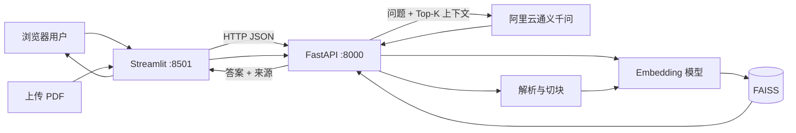

# 论文 RAG 问答系统

一个可本地运行的多文档 RAG 项目：上传 PDF 后自动解析、切块、向量化并重建 FAISS 索引；用户通过 Streamlit 聊天页面提问，FastAPI 后端检索相关片段，并调用阿里云百炼通义千问生成带文件名和页码引用的中文答案。

## 功能

- 多 PDF 加载与页面级 metadata
- 递归字符切块与重叠窗口
- 多语言 Sentence-Transformers Embedding
- FAISS 索引构建、保存、加载和 Top-K 检索
- MMR 与 Cross-Encoder Reranker 对比实验
- Hit@K、MRR 与查询延迟评估
- 阿里云百炼 OpenAI 兼容接口
- 仅依据检索上下文回答，资料不足时拒答
- 文件名、页码、Chunk ID 与距离引用
- FastAPI 后端与自动 OpenAPI 文档
- Streamlit 聊天前端和会话记录
- PDF 上传、校验、全量索引重建及热切换

## 系统架构



## 处理流程

```text
PDF
→ PyPDFLoader 按页读取
→ RecursiveCharacterTextSplitter 切块
→ paraphrase-multilingual-MiniLM-L12-v2 生成 384 维向量
→ FAISS 保存和检索
→ Top-K 上下文 + 用户问题
→ 通义千问生成中文答案
→ 返回答案、文件名、页码和 Chunk
```

## 项目结构

```text
rag-learning/
├── data/                    # 公开示例 PDF；运行时上传文件默认不提交
├── src/
│   ├── api.py               # FastAPI 接口、上传与索引热更新
│   ├── web_app.py           # Streamlit 聊天前端
│   ├── loader.py            # PDF → 页面 Document
│   ├── splitter.py          # 页面 → Chunks
│   ├── vectorstore.py       # Embedding、FAISS 构建/保存/加载
│   ├── llm.py               # 阿里云百炼 LLM 客户端
│   ├── rag.py               # 检索、上下文构造和答案生成
│   ├── reranker.py          # Cross-Encoder 重排序实验
│   ├── evaluate.py          # 检索评估
│   ├── evaluate_reranker.py # FAISS 与 Reranker 对比评估
│   └── compare_retrieval.py # 相似度检索与 MMR 对比
├── .env.example
├── requirements.txt
└── README.md
```

## 安装

推荐 Python 3.11 或更高版本。在项目目录创建虚拟环境：

```powershell
python -m venv .venv
.\.venv\Scripts\Activate.ps1
python -m pip install -r requirements.txt
```

首次运行会下载本地 Embedding 模型，约数百 MB；后续从本地缓存加载。

## 配置阿里云百炼

复制环境变量模板：

```powershell
Copy-Item .env.example .env
```

编辑 `.env`：

```env
DASHSCOPE_API_KEY=sk-your-api-key
DASHSCOPE_BASE_URL=https://dashscope.aliyuncs.com/compatible-mode/v1
LLM_MODEL=qwen3.8-max
RAG_API_URL=http://127.0.0.1:8000
```

API Key 与接口地域必须一致。`.env` 已被 Git 忽略，禁止提交真实密钥。

## 初始化向量索引

```powershell
python src/vectorstore.py
```

Windows 下索引默认保存到用户目录：

```text
%USERPROFILE%\rag-learning-faiss-index
```

这样可以规避部分 FAISS 版本对中文路径写入支持不完整的问题。

## 启动应用

### VS Code 一键启动

打开“运行和调试”，选择：

```text
启动完整 RAG Web
```

### 分别启动

后端：

```powershell
python -m uvicorn api:app --app-dir src --host 127.0.0.1 --port 8000 --reload
```

前端：

```powershell
python -m streamlit run src/web_app.py
```

访问地址：

- 聊天页面：<http://127.0.0.1:8501>
- API 文档：<http://127.0.0.1:8000/docs>
- 健康检查：<http://127.0.0.1:8000/health>

## API

| 方法 | 路径 | 说明 |
|---|---|---|
| `GET` | `/health` | 服务、向量数量和模型状态 |
| `GET` | `/documents` | 当前知识库 PDF 列表 |
| `POST` | `/ask` | RAG 问答 |
| `POST` | `/documents/upload` | 上传 PDF 并自动重建索引 |
| `POST` | `/reindex` | 手动完整重建索引 |

`POST /ask` 示例：

```json
{
  "question": "Sentence-BERT 如何降低语义相似度搜索成本？",
  "top_k": 5
}
```

## 检索评估

当前示例评估集结果：

| 方法 | Hit@1 | Hit@5 | MRR | 平均耗时 |
|---|---:|---:|---:|---:|
| FAISS | 87.5% | 100.0% | 0.9167 | 30.38 ms |
| FAISS + Reranker | 87.5% | 100.0% | 0.9375 | 464.57 ms |

Reranker 略微提升 MRR，但显著增加延迟，因此当前 Web 主链路默认使用普通 FAISS。评估集只有 8 个问题，这些结果用于教学和基线比较，不代表生产效果。

## 上传安全与索引更新

上传接口当前会：

- 只接受 `.pdf`
- 限制单文件最大 20 MB
- 校验 PDF 文件头及可解析页面
- 拒绝非法文件名、路径穿越和同名覆盖
- 使用锁避免并发重建
- 新索引成功保存后才热切换内存索引

当前采用全量重建，适合小型知识库。文档规模增大后应改为增量索引、任务队列和索引版本管理。

## 已知限制

- `PyPDFLoader` 主要提取文字流，不可靠保留复杂表格结构。
- 扫描 PDF 和图片表格需要 OCR/版面分析。
- 拒答目前主要依赖提示词，尚未完成大规模阈值校准。
- 没有用户认证、权限隔离、限流和持久化聊天记录。
- 本地 FAISS 更适合单机和中小规模知识库。

## 后续方向

- 使用 pdfplumber、Docling 或 PaddleOCR 增强表格/OCR 解析
- BM25 + 向量混合检索
- 增量索引、文档删除和索引版本管理
- 自动化 RAG 答案质量评估
- Docker、CI、日志、监控与云端部署
